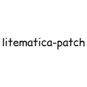

litematica-patch
==============
A small client-side patch mod for **Litematica** on **Minecraft 26.3**.

Litematica registers its own `litematica:pipeline/legacy/*` render pipelines with Iris
through `IrisCompat.registerPipelines()`. That registration is unfinished for the 26.3
renderpearl (Vulkan) renderer, so Iris tries to compile the generated
`sodium_terrain_*` shader variants and fails on startup:

```
[Render thread/ERROR]: failed to compile sodium_terrain_translucent.vsh:186:
  'constructor' : too many arguments
[Render thread/ERROR]: Couldn't compile pipeline (litematica:pipeline/legacy/*)
```

Instead of patching Litematica's source, this mod cancels that method with Mixin. It is
the runtime equivalent of setting `ASSIGN_TO_IRIS = false` in upstream.

---

### What it does

- Cancels `fi.dy.masa.litematica.compat.iris.IrisCompat#registerPipelines()` at `HEAD`
- Litematica's `LEGACY_*` pipelines are no longer assigned to
  `IrisProgram.TERRAIN_SOLID` / `TERRAIN_CUTOUT` / `TRANSLUCENT` / `LINES`
- Iris therefore never generates or compiles a `sodium_terrain_*` variant for them

### Credits

- **masa** and **Sakura-Ryoko** — Litematica
- **Mumfrey** - bytecode patching framework used by this mod
- **The Fabric project** — mod loader and build tooling
- **Iris Shaders** — for documenting the shader pipeline behaviour this patch works around
